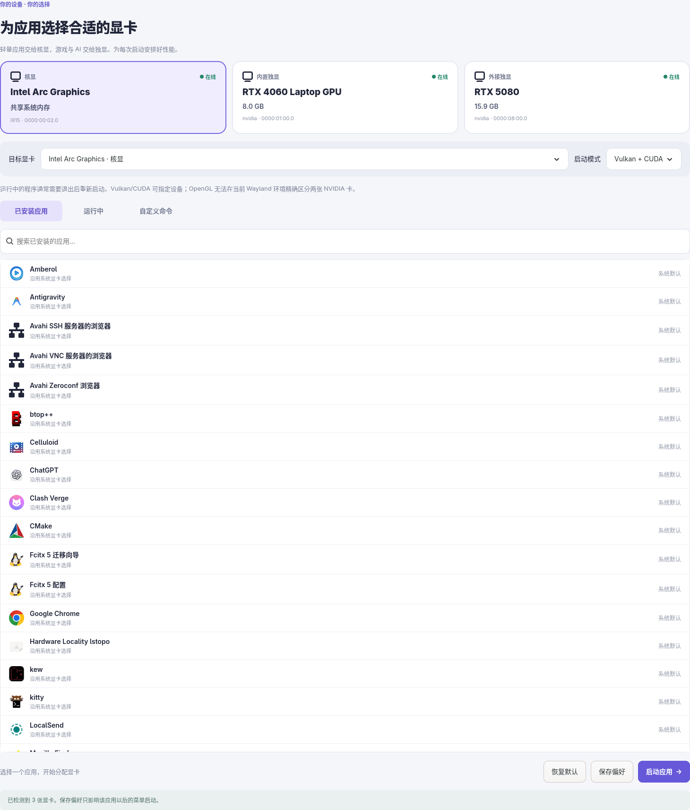

# 显卡选择器 · GPU Selector

Linux / GTK 4 桌面应用。自动检测 DRM 显卡和 NVIDIA UUID，让应用按选择的 GPU 启动。



## 安装与启动

目前在 Arch Linux + Niri / Wayland 上验证，其他发行版需要安装对应的 GTK 4、PyGObject 和 Mesa Vulkan device-select 层。

```bash
sudo pacman -S python-gobject gtk4 vulkan-mesa-implicit-layers pciutils
git clone https://github.com/pyrider3/gpu-selector.git
cd gpu-selector
bash install.sh
```

需要使用 NVIDIA GPU 时，请先安装适合显卡的驱动并确认 `nvidia-smi` 能正常识别。此工具不会安装驱动或授权 Thunderbolt 设备。

## 使用

在此目录运行 `bash install.sh` 安装到用户目录，无须管理员权限。之后从应用菜单搜索「显卡选择器」。也可直接运行 `python gpu_selector.py`。

1. 选择目标显卡和启动模式。
2. 在「已安装应用」里选择程序，点击「用所选显卡启动」。
3. 点击「保存以后启动偏好」会创建用户级桌面入口，以后从应用菜单启动生效。点击「恢复默认启动」撤销覆盖。
4. 「运行中」显示本用户的进程和可检测到的 GPU 使用情况，可把原命令放进「自定义命令」。自行退出原进程后重新启动，不会强制终止进程。
5. 热插拔显卡后点击「刷新设备」。指定的显卡离线时阻止启动并提示，不自动换到其他设备。

## 支持范围

- **Vulkan**：用 Mesa device-select 层选择 `vendor:device!`，只向应用暴露目标 GPU。本机已通过 `vulkaninfo` 验证核显、4060、5080。若应用显式禁用设备选择层或使用其他 GPU API，则可能不适用。
- **CUDA**：用 NVIDIA UUID 设置 `CUDA_VISIBLE_DEVICES`，避免重启或插拔后 GPU 数字编号变化。选择核显的 CUDA 模式会使用 CPU；核显 AI 可尝试应用支持的 Vulkan 后端。
- **OpenGL**：支持 Mesa 核显的 DRI_PRIME 选择。当前 Niri/Wayland 没有 RandR provider，不能保证专有 NVIDIA OpenGL 程序在两张 NVIDIA 卡间精确选择，所以该选项会拒绝 NVIDIA 目标。
- **运行中的程序**：通常不能直接迁移 GPU，需要退出重启。浏览器、Steam 等单实例应用可能把请求交给已运行的旧进程，需先完全退出。
- **后台服务**：桌面入口偏好不会修改 systemd 服务。Ollama 需要在 `ollama serve` 进程上选卡，而非 `ollama run`。先自行停止原服务，再从自定义命令启动 `ollama serve`。
- 保存的菜单偏好不影响直接从终端执行程序，也不会修改全局显卡设置或开启开机自启。
- 相同 vendor/device ID 的两张显卡：当前 Vulkan 层无法用该规则区分。本机三张卡的 ID 均不同。

## 依赖

本机已具备 Python、PyGObject、GTK 4、Mesa Vulkan 选择层和 NVIDIA 驱动。Arch 包通常为 `python-gobject gtk4 vulkan-mesa-implicit-layers pciutils`。NVIDIA 状态检测使用 `nvidia-smi`。

## 数据和日志

- 偏好、原始入口备份和日志：`~/.config/gpu-selector/`
- 应用菜单覆盖：`~/.local/share/applications/<应用ID>.desktop`
- 程序：`~/.local/share/gpu-selector/`

卸载前，在界面恢复已保存的应用偏好，再删除本工具的菜单入口和程序目录，避免留下指向已删除程序的入口。

## 已完成的验证

自动检测三张 GPU；分别用启动器运行 Vulkan 枚举验证只显示目标设备；应用启动环境传递；包含空格的文件参数传递；已有用户桌面入口备份恢复；新生成覆盖撤销；不支持的 OpenGL 操作拒绝；GTK 窗口启动和界面渲染。

环境变量机制参考：
- [Mesa 环境变量](https://docs.mesa3d.org/envvars.html)
- [Ollama GPU 文档](https://docs.ollama.com/gpu)
- [NVIDIA PRIME Render Offload](https://download.nvidia.com/XFree86/Linux-x86_64/545.29.06/README/primerenderoffload.html)

## 开发

```bash
python -m unittest discover -s tests -v
python -m py_compile gpu_selector.py
bash -n install.sh
```

自动检查覆盖启动环境和应用偏好的保存、恢复，不代替实际 GPU / 桌面环境验证。

欢迎通过 GitHub Issues 提交问题，请注明发行版、桌面环境、显卡型号和启动模式。分享日志前请删去个人路径及命令参数中的敏感信息。

## 许可证

[MIT](LICENSE)
